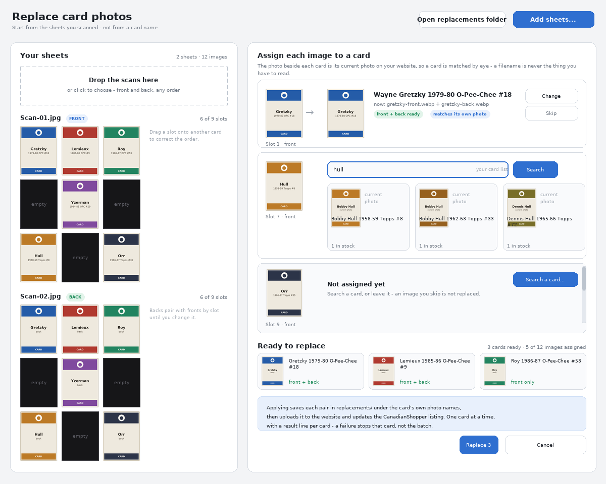

# Replacing card photos — proposed redesign

Status: mostly built. 2.52 ships the assignment window: one row per card image, filled by an AI read of the sheet, by the cards in scan order, or one at a time - and applied in a batch. Still proposals: matching a batch to an order number, and the nine-at-a-time queue with the "still needs a photo" list.



## The problem

The current **Photos** panel asks for a card name first, then a scan, then asks
"which image is the front?" by showing a text list of filenames:

```
Scan01_1.webp
Scan01_2.webp
Scan01_3.webp
```

Every tile has the same kind of name, so the only way to choose is to open the
files and memorise the positions. Front and back are then chosen twice, in two
separate passes, with no record of what was decided.

Replacing a photo is the same shape of job as the card pipeline: nine scans on a
sheet go in, nine cards come out. The pipeline is easier to use because you drop
the scans on it and stop thinking about filenames. This design makes photo
replacement work the same way, and adds the one thing the pipeline never needed:
a picture of each card, so a tile can be matched to a product by sight.

## Proposed flow

1. **Sheets first.** Drop the replacement scans onto the window (or click to
   choose, or take the newest files from the scan folder). Nothing asks for a
   card name to begin. Each sheet is split into its nine positions and shown as
   a 3×3 grid of pictures, with the empty slots left black and counted
   ("6 of 9 slots"). A sheet can be marked FRONT or BACK, and the app guesses
   which from the drag order and the filename, since it already learns that from
   the pipeline drop.
2. **Assign by eye, not by name.** Each usable tile gets a card. The way you
   confirm a card is its **current website photo**, shown next to the search:
   a product is recognised by the picture you already have of it, and the title
   is only a caption. Search is the way to narrow the list, never the thing you
   have to get exactly right.
3. **Backs follow fronts.** Once a front is assigned to a card, the tile in the
   *same slot position* of the back sheet is proposed as that card's back, and
   shown beside it. Overriding it is a click. This is what removes the second
   pass: both halves are chosen in one sitting, per card.
4. **Ready list, then apply.** Cards with both halves (or a deliberately
   front-only card) collect in a "Ready to replace" strip. Applying works one
   card at a time: name the pair from the card's own website image, save it into
   `replacements/`, upload to the site, then call the CanadianShopper plugin —
   the same order the current panel uses. A failure stops that card and moves on
   rather than ending the run.

### How a tile finds its card

Three sources, in this order, and the user always confirms:

- **The batch already waiting.** Products whose stock dropped without reaching
  zero (the order-number queue from issue #15) are matched first, since those
  are the cards actually being replaced today.
- **An AI read of the sheet**, optional. The pipeline already has prompts that
  read titles off a scan; a variant of that can propose a title per slot. It is
  a *suggestion*: its title fills the search box, and the photo confirms it.
  Slightly-wrong AI titles stop mattering because the picture decides.
- **A plain search.** Type anything — player, set, card number — and the
  results carry their current photo, so an ambiguous list can be resolved by
  looking rather than reading.

No filename is ever shown as the thing to reason about. It stays available as
a tooltip for support, not as a decision.

## Is this possible on Linux?

Yes. The pictures are the easy part: Pillow is already a dependency, and the
split already writes 600px webp tiles, which thumbnail cleanly. Thumbnails are
built with `ImageTk.PhotoImage` inside a try/except so the app still starts (and
still runs its headless tests) where tkinter is missing.

Drag and drop is the part with a caveat, and it is worth being precise:

- **Dropping onto the launcher** — the `.bat` icon, the desktop shortcut — is
  the operating system handing the app a list of files. It already works on both
  platforms. That is how the pipeline takes scans today.
- **Dropping onto a window** needs Tk to accept a drop, and Tk has no built-in
  support for it. It requires the `tkdnd` extension. The `tkinterdnd2` package
  carries prebuilt binaries for win-x64, win-x86, win-arm64, linux-x64 and
  linux-arm64 in one pure-Python wheel (about 820 KB, no compiler, one
  `pip install`). It attaches to a window the app already owns, so the drop zone
  can live in a single dialog rather than restructuring the app's main window.

So: a real drop zone in the window is available on both platforms for the price
of one optional dependency. It would be optional at runtime too — if the package
is absent the zone becomes a normal "Add sheets…" button, and nothing else
changes.

## What this replaces

The current panel's per-card flow (type a name → find product → pick tiles by
filename) would go. The work it does is kept, not rewritten: the split, the
`-front`/`-back` naming, `save_pair`, the website upload, the plugin version
gates, and the "leave the rest of the gallery alone" behaviour are all reused.

## Open questions

1. Assignment: click a tile then search a card (as drawn), or fill the nine
   slots from a filtered card list?
2. The AI read: wanted as an optional pre-fill, or never involved here?
3. Where this lives: replace the Photos panel, or a new tab that also holds the
   nine-at-a-time queue and the "still needs a photo" list from issue #15?
4. Scope now: the full window in one go, or pictures-in-the-current-picker first
   so the pain stops this week?
